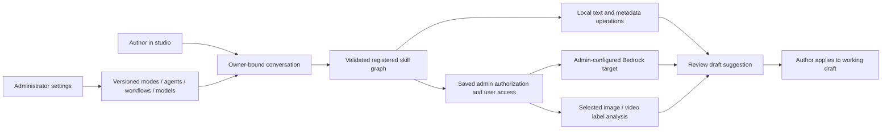

# Post assistant, agents and workflows

The publishing studio offers an optional conversation while creating a post. Authors can keep using the visual editor, choose an administrator-published mode, ask for help and review suggestions before applying them to the working draft. Starting a post, opening the assistant, saving configuration and uploading media do not invoke a model. An administrator’s saved authorization permits configured models to run when an allowed user explicitly sends a message or advances a workflow.

The implementation adapts Proposal Studio's versioned model/profile and validated skill-graph contracts, with NCAcademy's administrator-controlled modes and explicit assistance limits. Those projects do not provide a standalone shared SDK. Their proposal and student-tutoring implementations, runtime settings, credentials and private records are not imported into Axolotl News.

## Author workflow

1. Sign in through NCE Core and open the publishing studio.
2. Create a post, or open an existing draft, and choose the assistant option.
3. Select a published mode. Each mode binds an agent and a workflow; its welcome message explains its purpose.
4. Supply a message and any declared workflow inputs. Only explicitly selected draft/media context belongs to the conversation.
5. Review the conversation, recorded workflow steps and proposed title, excerpt, blocks or captions. Suggestions remain separate from the post until applied.
6. Apply a suggestion to the current working draft. If the post changed since the suggestion was prepared, start a new conversation with current context instead of overwriting newer work.
7. Save the draft and publish through the existing controls when ready. The assistant cannot publish or delete a post.

Conversations belong to the signed-in author. Sharing a draft or having publishing permission does not grant another person access to an author's private conversation. Current Core authority is checked on protected API requests. An author needs `posts-write`; administrator configuration requires `posts-write` and the dedicated `agents-manage` permission (or current Core organization-administrator authority). Publishing and account-management permissions alone do not allow changing model authorization or mode assignments.

## Run and validate locally without AWS

Use Node 22 or newer. This preview uses browser storage and deterministic coaching; it has no model transport and never falls back to a paid provider.

```bash
git clone --branch main \
  https://github.com/NorthCountryEngineer/Axolotl_News.git \
  "$HOME/axolotl-agent-preview" &&
cd "$HOME/axolotl-agent-preview"

node --version
npm ci --no-audit --no-fund
VITE_APP_MODE=local npm run dev
```

Open the local URL printed by Vite, choose **Editor's desk**, then **Open local editor**. Create a disposable titled post, add a picture and save its draft. Choose **Talk to an agent**, select that picture, review the context and begin the conversation. Send `Caption: My axolotl exploring the plants.` and optionally an `Alt: ...` line describing your image. Start the workflow and explicitly continue each of its three steps, then review and apply the suggestion. The draft becomes unsaved; no publication happens. Editing the draft disables application of the older suggestion.

As the local preview administrator, open **Agent settings**, add a mode, select its agent and workflow and save configuration. Change a workflow to contain a dependency cycle and confirm Save rejects it while preserving your edits. Reload the saved settings to recover. Keep **Allow configured paid models** off. Image/video recognition itself requires the deployed AWS provider authorized in saved settings and is intentionally unavailable in local preview.

## Administrative settings

Administrators configure the assistant's global enabled state, paid-execution opt-in, limits and four related registries:

| Registry | Configuration |
| --- | --- |
| Models | Stable ID, display name, local/generative/ML kind, local/Bedrock/Rekognition provider, exact invocation target, enabled state and maximum output tokens. |
| Agents | Stable ID, name, description, instructions, selected model ID and enabled state. |
| Workflows | Stable ID, name, description, enabled state and a versioned graph of registered skill steps. |
| Modes | Stable ID, name, description, welcome message, selected agent/workflow IDs, enabled state and audience: all editors or selected Core user IDs. |

The configuration is versioned. Writes must match its current revision; stale administrative edits cannot silently replace a newer configuration. Session acceptance captures the definitions needed for its execution. Later edits do not rewrite historical results. Current disable controls and the current mode audience still apply before every new turn. Revoking a user’s mode access stops their existing conversations from making further calls. Legacy modes without an audience remain available to all editors; newly created modes start without assigned users.

The limits bound conversation turns, workflow steps, input characters and model calls. These controls are not a dollar ceiling and are not a guarantee of zero AWS charges. Recorded Bedrock token usage describes reported consumption; Rekognition analysis has its own service billing units. This release does not invent token usage for image/video analysis.

## Workflow contract

Workflows use the same declarative graph shape as Proposal Studio:

```json
{
  "version": 1,
  "inputs": [{"name": "topic", "label": "Topic", "type": "string", "required": true}],
  "nodes": [{
    "id": "discuss",
    "skill": "agent.respond",
    "name": "Discuss the topic",
    "depends_on": [],
    "inputs": {"message": {"$input": "topic"}},
    "agent_id": "media-coach"
  }],
  "outputs": [{"name": "discussion", "node_id": "discuss"}]
}
```

Choose skill IDs from this application's returned catalog. The sample shows the graph/binding format; a graph must use available skills and valid agent/model bindings before it can run. `$input` refers to declared launch inputs, `$node` to a dependency's output and `$context` to supported current-post context. Graph validation rejects duplicate identifiers, cycles, unknown references, unavailable skills and invalid bindings. A deterministic coordinator runs the reviewed steps; model text cannot install code, tools or additional permissions.

The initial registered operations are `media.inventory`, `agent.respond`, `ml.image_labels`, `ml.video_labels` and `review.draft`. They combine local metadata/coaching, optional model text, bounded media observations and reviewed caption suggestions. Local coaching can prepare the author's supplied `Caption: ...` wording; it does not generate new prose from an AI model. Outputs remain untrusted working material. Axolotl facts require independent editorial checking, and an image label is not a biological identification or a health assessment. No browser automation, arbitrary HTTP connector, shell execution or generated executable code is provided to a post assistant.



## AI, ML and media boundaries

Local operations use text and supplied metadata without model inference. A local media inventory can report filenames, media types, captions and missing accessibility text; it does not inspect pixels, listen to audio or recognize video content. Local preview never calls a provider.

Generative inference uses the Bedrock Converse API with an administrator-selected model/target, bounded output and the Lambda workload role. No provider key belongs in a frontend environment variable. Only the exact invocation target saved in the selected administrator-configured model can run. The current mode audience and saved paid-model permission are checked on every turn. Account/model access and support for Converse must be established separately; adding a model record does not subscribe to, deploy or purchase a model. [Bedrock inference prerequisites](https://docs.aws.amazon.com/bedrock/latest/userguide/inference-prereq.html)

The model can return a response plus structured editorial suggestions. The server accepts only a bounded title, introduction, plain text blocks and captions for selected media. It constructs text nodes itself rather than accepting model HTML. A fact card can only restate existing captured fact text; that restriction does not verify the original claim. Publication state, media attachments, tool calls, arbitrary fields and captions for unselected files are rejected. An unsupported/malformed suggestion becomes plain guidance without a repair inference. The author still decides whether to apply valid suggestions, then uses the ordinary Save and Publish controls.

Media ML uses Rekognition label detection against explicitly selected private media already attached to this draft. JPEG/PNG images use `DetectLabels`. Supported MP4 video uses `StartLabelDetection`, persists the returned job ID and yields a waiting step. A subsequent explicit action retrieves a bounded result page with `GetLabelDetection`; opening or polling a conversation does not start another analysis. No SNS topic, service notification role or background polling worker is created. Large/multi-video production workloads should adopt AWS's recommended notification-based completion pattern rather than repeated status polling. [Image API](https://docs.aws.amazon.com/rekognition/latest/APIReference/API_DetectLabels.html), [video start API](https://docs.aws.amazon.com/rekognition/latest/APIReference/API_StartLabelDetection.html), [video completion guidance](https://docs.aws.amazon.com/rekognition/latest/dg/api-video.html)

Media labels can guide proposed captions and accessibility descriptions, with author review. They do not prove a species, behavior or factual claim. Provider output cannot change system instructions, elevate privileges or publish content. The application records visible conversation/results and reported usage; it does not collect hidden model reasoning.

The system persists an operation marker before an external send. Duplicate request IDs, concurrent turns and ambiguous outcomes must not silently repeat an inference or restart a video analysis. A timeout or uncertain provider outcome stops automatic continuation. Completed workflow steps remain recorded so an explicit continuation can reuse them.

| Protected API | Operation |
| --- | --- |
| `GET /assistant/config` | Read enabled configuration and service status as a writer. |
| `PUT /assistant/config` | Save the administrator configuration with its expected revision. |
| `POST /assistant/sessions` | Create one author-owned session from the reviewed post context. |
| `GET /assistant/sessions/{id}` | Read that author's session without model traffic. |
| `POST /assistant/sessions/{id}/turn` | Submit an idempotent chat, initialize a workflow or explicitly advance one step. |
| `DELETE /assistant/sessions/{id}` | Remove that author's conversation/results, preserving a minimal identifier tombstone against replay. |

There is no assistant endpoint for applying or publishing edits. Suggestion application updates the browser's working draft and follows the existing protected draft save/publish APIs. Starting a new conversation asks the author to delete the current conversation and its analysis before reviewing a new snapshot. Deleting a conversation does not delete the post or its uploads. Deleting a post does not automatically purge an assistant conversation; delete the conversation from the companion first if its captured text and results should also be removed.

This release provides configured inference and media analysis, not training. It does not submit training/fine-tuning jobs, create a dataset, train custom Rekognition models, host a SageMaker endpoint or automatically turn child-authored posts/conversations into training data. These require a separate data, evaluation, cost and release lifecycle before being offered as executable capabilities.

## AWS provider capability and administrator authorization

The existing stack retains separate private `AssistantState` storage, content tables and private media. The Lambda role includes provider invocation capability once; administrators do not need another stack change whenever they enable a model or assign a mode. The saved `allowPaidExecution` permission is the application’s authority for paid AI and ML. It defaults false, and configuration saves never invoke a provider.

A model, agent, mode and workflow must also be enabled and compatible, and the signed-in Core subject must be in the current mode audience. Disabling paid execution, a capability, or a user’s access stops subsequent calls in existing sessions. Enabling saved permission can apply to an existing session whose model definitions still match; changing capability bindings requires a new conversation.

The role grants only `bedrock:InvokeModel` on regional foundation models and this account’s regional inference profiles. US inference profile destination foundation models in `us-east-2` and `us-west-2` are included. The configured model ID or profile must support Converse and already be available to this AWS account. The role cannot subscribe to Marketplace products, deploy models, train models or modify IAM. A provider availability error remains a provider setup error rather than a second application approval gate. [Inference permissions](https://docs.aws.amazon.com/bedrock/latest/userguide/inference-prereq.html), [profile permissions](https://docs.aws.amazon.com/bedrock/latest/userguide/inference-profiles-prereq.html)

Rekognition permissions are limited to `DetectLabels`, `StartLabelDetection` and `GetLabelDetection` in the stack region. These operations do not support resource-level IAM ARNs, so their statement uses `Resource: "*"`; S3 access remains restricted to this application’s private media. There is no `iam:PassRole`, face-recognition, training, project or collection permission. [Rekognition authorization reference](https://docs.aws.amazon.com/service-authorization/latest/reference/list_rekognition.html)

The previous `AllowPaidModels`, `EnableMediaModels`, `BedrockModelAllowlist` and `BedrockResourceArns` stack parameters, and their Lambda environment switches, have been removed. Model targets come from versioned administrator settings rather than another deployment allowlist.

Turning permission off cannot cancel a request already sent to AWS or erase charges already incurred. Conversation limits bound operations rather than dollar spend. Hosting and storage have their own AWS usage charges.

## Release the existing installation: API first

These are operator-run instructions, not commands executed during development. Run them in one Terminal window and stop on any error. Verify the account and disable automatic frontend builds in step 1 before merging the reviewed source into `main`; this keeps the API update ahead of the frontend. The stack update retains the assistant table and updates invocation capability, and cloud upload/build/release usage can incur charges. This procedure preserves saved administrator settings and does not invoke a provider or create test users.

1. Select the existing account and verify it is `015454941623`:

   ```bash
   export PATH="$HOME/.local/bin:$PATH"
   export AWS_PROFILE="axolotl-deploy"
   export AWS_REGION="us-east-1"
   export AWS_DEFAULT_REGION="us-east-1"
   export AWS_PAGER=""
   unset AWS_ACCESS_KEY_ID AWS_SECRET_ACCESS_KEY AWS_SESSION_TOKEN AWS_SECURITY_TOKEN

   aws sts get-caller-identity \
     --profile axolotl-deploy --region us-east-1 \
     --query Account --output text
   ```

   If credentials expired, run `aws login --profile axolotl-deploy` and repeat the check. Do not proceed under a different account.

   Before merging the reviewed branch, keep the frontend release under manual control:

   ```bash
   aws amplify update-branch \
     --app-id d2v2mlkst3io2a --branch-name main \
     --no-enable-auto-build \
     --query 'branch.{Branch:branchName,AutoBuild:enableAutoBuild}' \
     --output table --profile axolotl-deploy --region us-east-1
   ```

   Confirm `AutoBuild` is `False`, then merge the reviewed `codex/post-agent-workflows` branch into `main` in GitHub. Continue with step 2. Do not re-enable automatic frontend builds during this release.

2. Clone the released source into your home directory to avoid the prior Documents-directory permissions problem:

   ```bash
   export AXOLOTL_RELEASE_DIR="$HOME/axolotl-assistant-release-$(date +%Y%m%d-%H%M%S)"
   git clone --branch main \
     https://github.com/NorthCountryEngineer/Axolotl_News.git \
     "$AXOLOTL_RELEASE_DIR" &&
   cd "$AXOLOTL_RELEASE_DIR" &&
   test -f docs/AGENT_WORKFLOWS.md &&
   python3 scripts/package-api.py
   ```

3. Prepare the archive and matching template. Keep the current shell open so the release variable survives:

   ```bash
   export AXOLOTL_ASSISTANT_CODE_KEY="releases/$(git rev-parse HEAD)/axolotl-api.zip"
   mkdir -p "$HOME/.axolotl-aws/assistant-release" &&
   cp infra/aws/build/axolotl-api.zip \
     "$HOME/.axolotl-aws/assistant-release/axolotl-api.zip" &&
   cp infra/aws/axolotl.template.json \
     "$HOME/.axolotl-aws/assistant-release/axolotl.template.json"
   ```

4. Upload the API archive:

   ```bash
   aws s3 cp \
     "$HOME/.axolotl-aws/assistant-release/axolotl-api.zip" \
     "s3://axolotl-news-code-015454941623-us-east-1/${AXOLOTL_ASSISTANT_CODE_KEY:?Run step 3 first}" \
     --profile axolotl-deploy --region us-east-1
   ```

5. Update the existing stack and wait for successful completion. The other existing parameters retain their current values:

   ```bash
   aws cloudformation deploy \
     --stack-name axolotl-news-production \
     --template-file "$HOME/.axolotl-aws/assistant-release/axolotl.template.json" \
     --capabilities CAPABILITY_IAM \
     --parameter-overrides \
       "LambdaCodeKey=${AXOLOTL_ASSISTANT_CODE_KEY:?Run step 3 first}" \
     --no-fail-on-empty-changeset \
     --profile axolotl-deploy --region us-east-1
   ```

6. Verify the updated function and API before releasing the frontend:

   ```bash
   aws lambda wait function-updated \
     --function-name axolotl-news-production-api \
     --profile axolotl-deploy --region us-east-1

   aws lambda get-function-configuration \
     --function-name axolotl-news-production-api \
     --query '{State:State,Update:LastUpdateStatus,AssistantTable:Environment.Variables.ASSISTANT_TABLE}' \
     --output table --profile axolotl-deploy --region us-east-1

   curl --fail --silent --show-error \
     "https://o0f7clx90f.execute-api.us-east-1.amazonaws.com/health"
   ```

   Expect `Active`, `Successful`, a populated assistant table and health status `ok`. No provider call is needed for this verification.

7. Start the existing Amplify frontend's release build:

   ```bash
   AXOLOTL_ASSISTANT_JOB_ID="$(aws amplify start-job \
     --app-id d2v2mlkst3io2a --branch-name main --job-type RELEASE \
     --query jobSummary.jobId --output text \
     --profile axolotl-deploy --region us-east-1)"
   ```

   After that command succeeds:

   ```bash
   export AXOLOTL_ASSISTANT_JOB_ID
   printf 'Amplify job: %s\n' "${AXOLOTL_ASSISTANT_JOB_ID:?Release was not started}"
   ```

8. Check this same job until its status is `SUCCEED`. Wait between checks; do not start another release to check progress:

   ```bash
   aws amplify get-job \
     --app-id d2v2mlkst3io2a --branch-name main \
     --job-id "${AXOLOTL_ASSISTANT_JOB_ID:?Run step 7 first}" \
     --query 'job.summary.{Status:status,Commit:commitId}' --output table \
     --profile axolotl-deploy --region us-east-1
   ```

   The completed commit must match `git rev-parse HEAD` in the release checkout. If the job fails or the API update fails, stop and inspect that failure before continuing.

9. Open the studio and hard-refresh:

   ```bash
   open "https://axolotl.news/studio"
   ```

   Sign in, open assistant settings as an administrator, review the saved authorization without changing it, and create a disposable post. Exercise a local mode, inspect a suggestion and apply it only to that disposable draft. Confirm ordinary writers can use assigned modes but cannot change administrative definitions or see unassigned modes. Confirm editor changes make older proposals stale and the original save/publish/delete controls still work. Use only local operations for this acceptance check; deployment itself is not a zero-cost operation.

The assistant authorization update requires no DNS or Cloudflare change. The separate Accounts feature requires its matching Core delegated-account API and migration to be released before account actions are available. Do not subscribe to models or run paid recognition merely to validate deployment.

## Verification boundaries

Regression tests use synthetic conversations, media manifests and mocked provider responses. No real provider invocation, AWS resource creation or cloud deployment belongs in the development test suite. Run the existing TypeScript/Python tests, typecheck, local preview build and packaging check. Infrastructure contract tests cover retained isolation, default-off administrator consent, bounded Bedrock invocation permissions and the narrowly bounded Rekognition policy.

Local JSON/contract validation does not prove a live CloudFormation update will succeed. Account-aware validation, deployer IAM permissions, quotas and provider/model availability must be checked by the operator at release time. `cfn-lint` and `cfn-guard` are not installed in the development environment; their schema/security validation and AWS service validation have not been run for this change. Record local validation, service validation, and live deployment evidence separately in release receipts.
