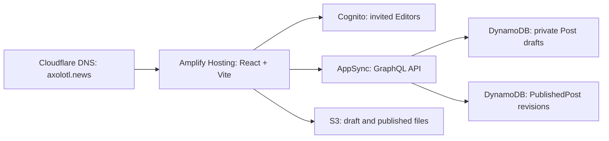

# Optional deployment: Cognito and Amplify Gen 2

**For the default NCE Core integration, follow [AWS_DEPLOYMENT.md](AWS_DEPLOYMENT.md).** This document describes the separate Cognito/Amplify Gen 2 alternative. Do not deploy both backends for the same Axolotl environment or run this document's `ampx pipeline-deploy` for NCE mode.

Prepared on October 11, 2026. The application and deployment recipe are local files. No AWS resources, accounts, subscriptions, deployments, DNS changes, or invitations were created while building this project.

**AWS hosting and backend usage can incur charges.** Local preview is the path that does not create cloud resources. If your requirement remains “no action that can incur a cost,” stop after step 1. The remaining steps are instructions for you to execute later after deciding to operate an AWS application. Read [COSTS.md](COSTS.md) first. The deployment gate is an acknowledgement in your build configuration, not a spending cap.

## What will run on AWS



The repository defines the backend in `amplify/`; you do not need to manually create an API, tables, Cognito pool, or media bucket. Amplify Gen 2 creates them from those TypeScript definitions. Public readers receive guest identity credentials for read access; editors sign in to Cognito. The API layer is AppSync GraphQL, accessed through the Amplify data client. [Amplify quickstart](https://docs.amplify.aws/react/start/quickstart/), [AppSync overview](https://docs.aws.amazon.com/appsync/latest/devguide/).

The application's authorization contract is:

| Resource | Public reader | Signed-in user outside Editors | Editors |
| --- | --- | --- | --- |
| `Post` draft records | No access | No access | Create, read, update, delete |
| `PublishedPost` records | Read | Read | Create, read, update, delete |
| S3 `drafts/*` | No access | No access | Read, write, delete |
| S3 `published/*` | Read through the application | Read | Read, write, delete |

Self-registration is disabled in the Cognito backend, in addition to having no sign-up form. All Editors can manage all drafts; this is a small, trusted family editorial team. S3 remains an authenticated AWS storage service with scoped IAM access; do not turn off S3 Block Public Access or make the entire bucket public. [Amplify data authorization](https://docs.amplify.aws/react/build-a-backend/data/customize-authz/), [Storage authorization](https://docs.amplify.aws/react/build-a-backend/storage/authorization/), [Cognito invite-only setting](https://docs.aws.amazon.com/AWSCloudFormation/latest/TemplateReference/aws-properties-cognito-userpool-admincreateuserconfig.html).

## 1. Run and review locally

Open a terminal in the project directory. Use Node.js 22 LTS; the declared minimum is Node 20.18.0. Dependencies are installed inside this project, without a global installation.

```bash
cd Axolotl_News
npm ci --offline --ignore-scripts --no-audit --no-fund
npm run dev
```

Visit the localhost URL printed by Vite, normally `http://127.0.0.1:5173`. Select **Editor’s desk**, or open `/studio`, then choose **Open local editor**. Local mode starts with no blog posts and provides browser-local drafts and media. It does not contact AWS. Review the story, create a new Story or Newsletter, add files, and use **Save draft**. There is no autosave; an upload alone does not save the draft's document. Data in local mode belongs to that browser and is not a backup or a shared production database.

Local verification and a static preview:

```bash
npm run typecheck
npm test
npm run build:preview
npm run preview
```

`npm run build:preview` deliberately produces a local demo. Do not deploy that build as the production site. `npm run build` requires cloud mode and valid backend outputs. Do not run `npx ampx sandbox`: it provisions an actual AWS backend, even though the frontend runs on localhost. [Amplify cloud sandbox behavior](https://docs.amplify.aws/react/start/quickstart/).

## 2. Prepare your accounts and repository

1. Use your existing AWS account and Cloudflare account. Keep `axolotl.news` registered at Cloudflare with its current Cloudflare nameservers. There is no need to transfer the domain or create a Route 53 hosted zone.
2. In AWS Billing and Cost Management, review the account's plan, remaining credits, Free Tier eligibility, and current spend. Optional cost notifications are described in [COSTS.md](COSTS.md).
3. Sign in to AWS as a parent-controlled IAM identity with permission to create the Amplify application and its deployment role. Keep AWS root credentials out of the site and repository.
4. Put this complete repository, including `package-lock.json`, `amplify.yml`, and `amplify/`, in a Git repository on an existing provider supported by Amplify. A private repository is suitable. Keep the pinned dependency versions and overrides together with the lockfile. Do not commit `.env.local`, AWS credentials, `node_modules`, `dist`, or the generated `amplify_outputs.json`.
5. Choose one AWS Region for the backend, such as `us-east-1`, and record it. Use the same Region when administering Cognito and inspecting backend resources.

Amplify's Git connection authorizes repository access and runs deployments after pushes. Connecting a repository is part of the AWS setup you perform, not something performed by this project. [Amplify Hosting](https://docs.amplify.aws/react/deploy-and-host/amplify-hosting/).

## 3. Create the Amplify application and deployment role

**This step begins cloud setup and may incur charges.** Even a failed build consumes build time; the gate cannot make an Amplify build free.

1. In the AWS Amplify console in your chosen Region, choose **Create new app**, select your existing Git provider, authorize the repository connection, and select this repository and the `main` branch.
2. Name the application `axolotl-news`. Use the supplied `amplify.yml` rather than replacing it with a frontend-only template. The app root is the repository root and the build artifact directory is `dist`.
3. For the backend deployment service role, allow Amplify to create the **Amplify - Backend Deployment** role, or select an existing role created for that use case. The role needs the AWS-managed `AmplifyBackendDeployFullAccess` policy and its associated CDK deployment permissions. This is a powerful deployment role; do not give these permissions to the child’s Cognito editor account. The default use-case trust policy includes account/source conditions. [Create the service role](https://docs.aws.amazon.com/amplify/latest/userguide/amplify-service-role.html), [Managed policy reference](https://docs.aws.amazon.com/aws-managed-policy/latest/reference/AmplifyBackendDeployFullAccess.html).
4. Use the Amazon Linux 2023 build image and select Node.js **22** in **Hosting → Build settings → Build image settings** if an override is needed. Avoid `latest` for the Node override. [Amplify build image configuration](https://docs.aws.amazon.com/amplify/latest/userguide/custom-build-image.html).
5. In the app or branch’s environment variable settings, add:

   | Name | Value | Purpose |
   | --- | --- | --- |
   | `AXOLOTL_ENABLE_AWS_DEPLOYMENT` | `true` | Explicitly enables the supplied backend deployment recipe |
   | `VITE_APP_MODE` | `cloud` | Builds the frontend for Cognito, AppSync, and S3 |

6. Let Amplify supply `AWS_APP_ID` and `AWS_BRANCH`; do not create replacement variables with those names. No secret or AWS access key belongs in a `VITE_` variable, because frontend variables are bundled into the browser. [Amplify environment variables](https://docs.aws.amazon.com/amplify/latest/userguide/environment-variables.html).
7. Disable branch auto-detection and pull-request previews for the initial family site. Keep only the `main` environment to avoid extra backend deployments. If you want deployment only when requested, disable automatic builds after the first successful deployment and trigger builds manually.
8. Choose **Save and deploy** when you have decided to run the application on AWS. Record the Amplify App ID, branch name, backend Region, default hosted URL, and deployed CloudFormation stack name/ARN from the app's deployed resource details.

The supplied build specification checks the deployment gate, then runs:

```bash
npm ci --no-audit --no-fund
npx ampx pipeline-deploy --branch "$AWS_BRANCH" --app-id "$AWS_APP_ID"
npm run build
```

`pipeline-deploy` creates or updates the backend and produces the branch's `amplify_outputs.json` before Vite builds. The file contains client connection configuration, not administrator credentials. Do not hand-invent its resource IDs or use the configuration of another branch. [Gen 2 pipeline deployment](https://docs.amplify.aws/react/deploy-and-host/fullstack-branching/custom-pipelines/), [Amplify outputs](https://docs.amplify.aws/react/reference/amplify_outputs/).

If the build fails, inspect the earliest failure in the build logs and the relevant CloudFormation stack events. Check environment gates, Node version, lockfile, and service role before retrying. A deployment is verified only after its backend and frontend phases both succeed.

## 4. Invite your editor account

The backend creates the `Editors` group. An invited Cognito account must belong to that group to create content. Use a parent-controlled email address or alias for the invitation; the public blog author label does not need to reveal the login address.

First, download `amplify_outputs.json` from the deployed branch’s backend resources panel, or copy the user pool ID and Region from Cognito. The JSON keys are `auth.user_pool_id` and `auth.aws_region`. The file may be placed at the repository root for local cloud development, but remains ignored by Git. [Downloading backend outputs](https://docs.amplify.aws/react/start/quickstart/).

You can perform the equivalent account creation and group assignment in the Cognito console. For AWS CLI v2, use an existing authorized profile. If your existing account already uses IAM Identity Center, configure a named profile and log in:

```bash
aws configure sso --profile axolotl-admin
aws sso login --profile axolotl-admin
aws sts get-caller-identity --profile axolotl-admin
```

Verify that the returned AWS account is the one hosting this application. The SSO wizard needs your existing organization's start URL, SSO Region, account, and role; it does not create Identity Center for you. If you do not already use SSO, use your established AWS CLI authentication method or the Cognito console. [AWS CLI SSO configuration](https://docs.aws.amazon.com/cli/latest/userguide/cli-configure-sso.html).

Replace these sample values with actual deployed values:

```bash
AXOLOTL_AWS_REGION='us-east-1'
AXOLOTL_USER_POOL_ID='REPLACE_WITH_DEPLOYED_USER_POOL_ID'
AXOLOTL_EDITOR_EMAIL='REPLACE_WITH_PARENT_CONTROLLED_EMAIL'

AXOLOTL_EDITOR_USERNAME=$(aws cognito-idp admin-create-user \
  --profile axolotl-admin \
  --region "$AXOLOTL_AWS_REGION" \
  --user-pool-id "$AXOLOTL_USER_POOL_ID" \
  --username "$AXOLOTL_EDITOR_EMAIL" \
  --user-attributes Name=email,Value="$AXOLOTL_EDITOR_EMAIL" Name=email_verified,Value=true \
  --desired-delivery-mediums EMAIL \
  --query 'User.Username' \
  --output text)
```

Cognito sends an email invitation with a temporary password. The command captures Cognito's actual username, which may differ from the email address. Mark an address verified only when you control and have verified it. Do not add `SUPPRESS` unless you have a separate plan to deliver a temporary password. First sign-in requires a new password. [AdminCreateUser command](https://docs.aws.amazon.com/cli/latest/reference/cognito-idp/admin-create-user.html).

After the command succeeds, assign the group:

```bash
aws cognito-idp admin-add-user-to-group \
  --profile axolotl-admin \
  --region "$AXOLOTL_AWS_REGION" \
  --user-pool-id "$AXOLOTL_USER_POOL_ID" \
  --username "$AXOLOTL_EDITOR_USERNAME" \
  --group-name Editors

aws cognito-idp admin-list-groups-for-user \
  --profile axolotl-admin \
  --region "$AXOLOTL_AWS_REGION" \
  --user-pool-id "$AXOLOTL_USER_POOL_ID" \
  --username "$AXOLOTL_EDITOR_USERNAME"
```

Confirm the returned group is exactly `Editors`, including capitalization. Open the site’s editor sign-in, use the invited email and temporary password, and complete the change-password step. Sign out and back in after any group change so the session receives fresh group claims. [AdminAddUserToGroup command](https://docs.aws.amazon.com/cli/latest/reference/cognito-idp/admin-add-user-to-group.html).

For an administrator profile dedicated to invitations, the relevant permissions can be scoped to this one pool instead of granting full deployment access:

```json
{
  "Version": "2012-10-17",
  "Statement": [{
    "Effect": "Allow",
    "Action": [
      "cognito-idp:AdminCreateUser",
      "cognito-idp:AdminAddUserToGroup",
      "cognito-idp:AdminListGroupsForUser",
      "cognito-idp:AdminRemoveUserFromGroup",
      "cognito-idp:AdminDisableUser"
    ],
    "Resource": "arn:aws:cognito-idp:REGION:ACCOUNT_ID:userpool/USER_POOL_ID"
  }]
}
```

Substitute your Region, account ID, and pool ID before applying this policy. The policy is for your parent/admin IAM identity; browser users never receive these admin actions. Each Cognito admin action requires IAM permission. [Auth administration permissions](https://docs.amplify.aws/react/build-a-backend/auth/grant-access-to-auth-resources/).

## 5. Configure the frontend route rewrite

In Amplify **Hosting → Rewrites and redirects**, add a **200 rewrite** to `/index.html` for SPA paths. Preserve actual media and static asset requests. This variant of AWS's example excludes the file types used by this project:

```json
[
  {
    "source": "</^[^.]+$|\\.(?!(css|gif|ico|jpg|jpeg|js|png|txt|svg|woff|woff2|ttf|map|json|webp|avif|mp4|webm|pdf)$)([^.]+$)/>",
    "target": "/index.html",
    "status": "200",
    "condition": null
  }
]
```

Keep any domain redirect above the SPA rewrite. Do not rewrite every existing static file to HTML. Open an inner page directly and reload it to verify the rule. [AWS SPA rewrite examples](https://docs.aws.amazon.com/amplify/latest/userguide/redirect-rewrite-examples.html).

## 6. Connect axolotl.news using Cloudflare DNS

1. In the Amplify app, open **Hosting → Custom domains → Add domain** and enter `axolotl.news`.
2. Choose **Manual configuration**. Keep Cloudflare as DNS provider; do not accept the option to create a Route 53 hosted zone.
3. Map the apex domain and `www` to the `main` branch. Amplify defaults to an apex-to-`www` redirect; turn that off if you want `axolotl.news` to remain in the address bar. Both hostnames can serve the same branch.
4. Choose **Amplify managed certificate**, then add the domain. Open **Actions → View DNS records**. [AWS third-party domain configuration](https://docs.aws.amazon.com/amplify/latest/userguide/to-add-a-custom-domain-managed-by-a-third-party-dns-provider.html).

In Cloudflare, select `axolotl.news`, then **DNS → Records**. Add records using the **exact names and targets Amplify supplies**:

| Type | Name in Cloudflare | Target | Proxy status | TTL |
| --- | --- | --- | --- | --- |
| CNAME | `@` | The apex routing target from Amplify, typically `ACTUAL_VALUE.cloudfront.net` | DNS only, gray cloud | Auto |
| CNAME | `www` | The `www` routing target from Amplify | DNS only, gray cloud | Auto |
| CNAME | The validation name, typically `_ACTUAL_TOKEN` | The exact ACM target, typically `_ACTUAL_TOKEN.ACTUAL_SUFFIX.acm-validations.aws` | DNS only, gray cloud | Auto |

There may be more than one certificate validation record; create each record listed. If Amplify shows a name ending in `.axolotl.news`, enter the relative part once; avoid a duplicated `.axolotl.news.axolotl.news`. Targets are DNS names without `https://`, paths, or quotation marks. Before replacing a conflicting `A`, `AAAA`, or `CNAME` at `@` or `www`, confirm it belongs to the old website; preserve unrelated MX, TXT, and email records.

Cloudflare automatically flattens a CNAME at `@`, so no IP address, `A` record pointing at a hostname, ANAME, or paid DNS feature is required. Keep all routing records DNS-only during Amplify verification. Keep ACM validation records DNS-only permanently for renewal. [AWS Cloudflare procedure](https://docs.aws.amazon.com/amplify/latest/userguide/to-add-a-custom-domain-managed-by-cloudflare.html), [Cloudflare apex records](https://developers.cloudflare.com/dns/manage-dns-records/how-to/create-zone-apex/).

Do not enable “flatten all CNAMEs”; validation records must remain visible as CNAMEs. If your zone already has a per-record flattening setting, disable it on validation records. Leave the routing records DNS-only for this setup; Amplify already provides HTTPS and CDN hosting. [Cloudflare Amplify record reference](https://developers.cloudflare.com/dns/manage-dns-records/reference/vendor-specific-records/).

If restrictive CAA records already exist, check that they authorize an Amazon CA such as `amazon.com` or `amazontrust.com`. A standard non-wildcard permission is CAA flag `0`, tag `issue`, value `amazon.com`. Keep any CAA permissions needed by your other services. If there are no CAA records, adding one is not required to obtain the Amplify certificate. [ACM CAA troubleshooting](https://docs.aws.amazon.com/acm/latest/userguide/troubleshooting-caa.html).

Wait for Amplify’s custom domain status to become **Available**, then open `https://axolotl.news` and `https://www.axolotl.news`. AWS says third-party DNS verification can take up to 48 hours. Retain the certificate validation records. Do not guess an IP address or repeatedly delete/re-add a pending domain. [Custom domain troubleshooting](https://docs.aws.amazon.com/amplify/latest/userguide/troubleshooting-custom-domains.html).

Optional read-only DNS checks after you add the records:

```bash
dig +short axolotl.news A
dig +short www.axolotl.news CNAME
dig +short _ACTUAL_VALIDATION_NAME.axolotl.news CNAME
```

The apex may return IP addresses due to flattening; that is expected. The validation query should return the exact ACM target. Use the actual record name, not the placeholder above.

## 7. Confirm the deployment works

Perform this check on the default Amplify URL first, then on the custom domain. These cloud checks create normal AWS usage.

- [ ] A signed-out/private browser can read the presentation and the public blog without signing in.
- [ ] The build uses cloud mode and the deployed outputs; the hosted site does not expose the local demo editor.
- [ ] There is no sign-up UI, and the deployed Cognito pool has self-registration disabled.
- [ ] An invited Editor can complete the first-login password change and reopen a saved draft after signing out and back in.
- [ ] Add text, an image upload, and a short video or video link; reorder the content, preview, and select **Save draft**. Reload the editor and reopen it to confirm the manual save. Uploaded draft keys are under `drafts/`.
- [ ] In a signed-out browser, that new draft is absent. Test the backend rules as well: a guest or non-Editor Amplify client must receive an authorization error for `Post` reads/writes, draft storage reads, and all writes to published data/media.
- [ ] Publish the post. The signed-out browser can now see its public revision and media. Published media keys are under `published/` and do not reference `drafts/`.
- [ ] Edit and save the private draft. Reload the public article and confirm it still shows the prior published revision. Publish again to replace it.
- [ ] Unpublish the article. It disappears from public reads while the private draft remains editable. Select **Clear old media** while the post remains unpublished; old public file links then stop working, and draft media remains available.
- [ ] On a disposable test post, unpublish and select **Delete draft**. Confirm its public media, draft uploads, and private record are removed. This is destructive; use content you intend to delete.
- [ ] Reload an inner page, test on a phone-sized screen, play the uploaded video, and confirm both domain hostnames have valid HTTPS.
- [ ] Check AWS Billing afterward and confirm that only the intended `main` backend exists.

The local checks validate application code and the authorization definitions; they do not prove deployed IAM/Cognito/AppSync behavior. Keep the cloud acceptance checks pending until you perform them.

## 8. Publish, maintain, and back up

Publishing copies referenced draft uploads into a new `published/<post-id>/<publication-id>/...` path, rewrites those references in the public document, and updates the `PublishedPost` revision only after the uploads succeed. The same UUID identifies its private and public records. This avoids silently publishing draft changes. Editor accounts are trusted to publish and modify public projections; publication is implemented by the client using the API and S3 permissions, without a separate moderation service.

Unpublishing removes the public article record. It does not automatically delete prior published files. An existing public media key may still be fetched through guest access until an Editor or administrator explicitly deletes it. The app's signed media URLs expire after 15 minutes, but guest access can create another URL while the file exists. Already downloaded/cached copies cannot be recalled.

To remove the public files, unpublish the post and select **Clear old media**. Both local and cloud mode require the post to be unpublished. Cleanup removes the entire `published/<post-id>/` prefix, including prior revisions. Keep the post unpublished until cleanup finishes; another Editor must not republish it concurrently. Its private draft media remains available for later publication. As an administrator fallback, confirm the article is unpublished before deleting its exact `published/<post-id>/` objects in S3. Do not apply an age-based deletion rule to current published media.

**Delete draft** also requires an unpublished post. It removes the post's old public media and draft uploads before deleting its private record. Export the document and keep the original media first if you want a copy. If storage cleanup fails partway through, the record can remain while some files have been removed; inspect the error, keep the post unpublished, and retry the deletion rather than assuming it completed.

Before major backend schema changes or teardown, use **Export draft** for each document you want to keep and separately retain/download its original media. The JSON export stores media keys as references; it does not contain the image, video, or PDF bytes. **Import text draft** accepts text-only draft JSON and rejects documents containing uploaded-media references. To move a media-rich creation between local and cloud mode, recreate/import its text and upload the original files again; publishing locally does not migrate a post to AWS. A newsletter is a published document/layout in this application; sending email newsletters or managing a mailing list is not included. The Canva story's transcribed text is bundled in the frontend; original artwork import is described in [CANVA.md](CANVA.md). The site does not require a Canva API token at runtime.

To update code, run the local checks, commit the change, then start a build (or push if automatic builds remain enabled). A Git rollback restores code only; it does not roll back database changes or deleted files. Do not set `AMPLIFY_DESTRUCTIVE_UPDATES=true` as a routine fix for a schema failure; review data migration impact first.

To use a deployed backend from your own localhost browser, download that branch's outputs to the repository root and use a local environment file containing `VITE_APP_MODE=cloud`. This reads/writes the real backend and can incur usage; remove the setting to return to the safe local demo. No new sandbox is needed.

## 9. Remove access or shut the site down

To revoke editorial access, use Cognito **Users → your user → Group memberships**, remove `Editors`, and disable the account if it should no longer sign in. CLI equivalents use the actual username and pool values from step 4:

```bash
aws cognito-idp admin-remove-user-from-group \
  --profile axolotl-admin \
  --region "$AXOLOTL_AWS_REGION" \
  --user-pool-id "$AXOLOTL_USER_POOL_ID" \
  --username "$AXOLOTL_EDITOR_USERNAME" \
  --group-name Editors

aws cognito-idp admin-disable-user \
  --profile axolotl-admin \
  --region "$AXOLOTL_AWS_REGION" \
  --user-pool-id "$AXOLOTL_USER_POOL_ID" \
  --username "$AXOLOTL_EDITOR_USERNAME"
```

Existing tokens/temporary credentials can remain usable until their expiration; do not assume a group change instantly invalidates every issued credential. [Remove group membership](https://docs.aws.amazon.com/cli/latest/reference/cognito-idp/admin-remove-user-from-group.html), [Disable user](https://docs.aws.amazon.com/cli/latest/reference/cognito-idp/admin-disable-user.html).

Full teardown is destructive and should be done only when you intend to remove this site. The installed, pinned storage library generates a bucket with automatic object deletion and a destroy policy; locally synthesized data templates also give both content tables delete policies. A successful backend stack deletion can remove all uploaded media, drafts, and published records. Keep your original files and document exports before proceeding; inspect the actual deployed policies and deletion result.

1. Export/download any wanted posts and media. Record this app’s resource IDs and root CloudFormation stack ARN before deleting the app.
2. Disable automatic builds, branch auto-detection, and previews so Git activity cannot recreate resources.
3. In Cloudflare, remove this app's routing and certificate validation CNAME records when retiring its domain association. Keep the domain registration and unrelated records if you still want them.
4. In Amplify, remove the custom domain association, then use **App settings → General settings → Delete app**. [AWS application cleanup](https://docs.aws.amazon.com/hands-on/latest/build-web-app-s3-lambda-api-gateway-dynamodb/module-six.html).
5. In the backend Region’s CloudFormation console, verify the recorded Gen 2 root stack and its nested stacks were deleted. If a root stack remains, review its Resources tab to confirm it belongs to this app, then delete that root stack. Do not use Gen 1 `delete-backend-environment` commands for a Gen 2 backend.
6. Review `DELETE_FAILED` and `DELETE_SKIPPED` resources, retained DynamoDB tables, S3 buckets and object versions, CloudWatch log groups, and app-specific deployment roles. Retained resources can continue to cost money. Empty/delete only this app's retained buckets after backing up what you need. Never delete a shared CDK bootstrap stack or shared role simply because this app used it. [CloudFormation deletion and retained resources](https://docs.aws.amazon.com/AWSCloudFormation/latest/UserGuide/cfn-console-delete-stack.html).
7. Recheck Billing in later updates for residual usage. Removing DNS or disabling builds alone does not shut down the backend or erase stored media.

The actual deployed deletion policies are authoritative. This project has not deployed or tested resource removal. Review them before teardown; deletion of a CloudFormation stack cannot be stopped once started.
